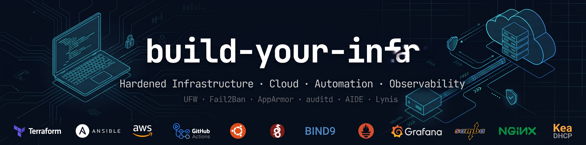
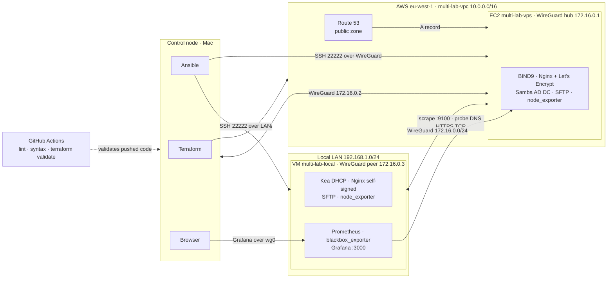

# build-your-infra — Multi-Environment Infrastructure Lab

[](https://github.com/Bios-Mod/build-your-infra/actions/workflows/push-ci.yml)
[](https://github.com/Bios-Mod/build-your-infra/actions/workflows/pull-request.yml)

[](modules/hardening/self-managed/hardening-self-managed.md)
[](modules/hardening/self-managed/hardening-self-managed.md)
[](modules/hardening/self-managed/hardening-self-managed.md)
[](modules/hardening/self-managed/hardening-self-managed.md)
[](modules/hardening/self-managed/hardening-self-managed.md)
[](modules/hardening/self-managed/hardening-self-managed.md)
[](modules/hardening/self-managed/hardening-self-managed.md)
[](modules/hardening/aws-native/hardening-aws-native.md)
[](modules/hardening/aws-native/hardening-aws-native.md)
[](modules/hardening/aws-native/hardening-aws-native.md)

[](environments/local/local-vm-setup.md)
[](modules/file-transfer/self-managed/file-transfer-self-managed.md)
[](modules/dns/self-managed/dns-self-managed.md)
[](modules/web-server/self-managed/web-server-self-managed.md)
[](modules/directory/self-managed/directory-self-managed.md)
[](modules/dhcp/self-managed/dhcp-self-managed.md)
[](stacks/full-infra/self-managed/automation/self-managed-automation.md)
[](stacks/full-infra/self-managed/automation/self-managed-automation.md)

[](environments/vps/vps-ec2-setup.md)
[](modules/hardening/aws-native/hardening-aws-native.md)
[](modules/file-transfer/aws-native/file-transfer-aws-native.md)
[](modules/dns/aws-native/dns-aws-native.md)
[](modules/web-server/aws-native/web-server-aws-native.md)
[](modules/web-server/aws-native/web-server-aws-native.md)
[](modules/web-server/aws-native/web-server-aws-native.md)
[](modules/directory/aws-native/directory-aws-native.md)

Server infrastructure is usually built once by hand and never reproduced: configurations drift, security baselines are undocumented, and nobody remembers why a setting was chosen. This lab solves that by deploying the same service set (hardening, file transfer, DNS, web, directory, DHCP, monitoring) across three environments — local VM, VPS and AWS Native — documenting the reasoning behind every decision inline, and then automating each layer with the tool that fits it: Terraform provisions, Ansible configures, GitHub Actions validates.

Built and tested on Ubuntu Server 24.04 LTS. Deployments use both the AWS Management Console (where the GUI provides the clearest workflow) and the CLI.

The same services are also deployed as Docker containers in
[containerize-your-infra](https://github.com/Bios-Mod/containerize-your-infra)
— a parallel lab covering the same stack at a different level of abstraction.
That repo documents the containerized equivalent of each module here:
Nginx, BIND9, SFTP, and reverse proxy via Traefik v3, deployed with Docker
Engine and Compose v2 across dev (OrbStack on macOS) and prod
(Ubuntu 24.04 LTS · EC2 t4g.micro) environments.

---

## Environments

| Component | Local (VM) | VPS / EC2 | AWS Native |
| --- | --- | --- | --- |
| OS | Ubuntu Server 24.04 LTS | Ubuntu Server 24.04 LTS | Managed (per service) |
| Architecture | ARM64 (Apple Silicon) / x86_64 | ARM64 (Graviton2) | — |
| Deployment | VMware Fusion / VirtualBox · Bridged network | EC2 t4g.micro · eu-west-1 | AWS managed services · eu-west-1 |
| Network | Static IP · LAN | Elastic IP · VPC | VPC · private subnets |
| Remote Access | SSH Ed25519 · port 22222 · WireGuard VPN | SSH Ed25519 · port 22222 · WireGuard VPN | SSM Session Manager / service APIs |

`local` and `vps` follow the same self-managed hardening baseline. `aws-native`
replaces each service with its AWS managed equivalent — no OS to manage.

> See [`environments/README.md`](environments/README.md) for
> environment setup guides and when to use each.
>
> **Architecture note:** Built and tested on ARM64 (Apple
> Silicon via VMware Fusion and AWS Graviton2).
> All configurations are architecture-agnostic except
> where noted. x86_64 users can follow the same steps —
> differences are called out inline.

---

## Architecture

Three planes connect through one WireGuard network. The Mac drives Terraform and Ansible, the EC2 instance is the WireGuard hub and public edge, and the local VM is a peer that also hosts the monitoring stack. GitHub Actions validates every change before it reaches `main`.



The monitoring server runs on the local VM and reaches the EC2 hub only through `wg0`. Grafana is reachable only over WireGuard, keeping metrics and dashboards off public networks. The `aws-native` path (Managed AD, Transfer Family, CloudFront) is an independent alternative not shown here.

---

## Deploying This Lab

Choose your environment and follow its setup guide before applying any module:

- **Local VM** — Ubuntu Server 24.04 LTS · VMware Fusion / VirtualBox (bridged adapter) → [`environments/local/local-vm-setup.md`](environments/local/local-vm-setup.md)
- **VPS / EC2** — Ubuntu Server 24.04 LTS on any cloud provider → [`environments/vps/vps-ec2-setup.md`](environments/vps/vps-ec2-setup.md)
- **AWS Native** — AWS account with IAM user, custom VPC, and base security services enabled → [`environments/aws-native/aws-native-setup.md`](environments/aws-native/aws-native-setup.md)

Apply modules in order — `hardening` is the only hard prerequisite. All other
modules are independent and can be deployed individually on top of the
hardened base.

---

## Modules

### Foundation

| Module | Self-Managed Technology | AWS Native Technology | Doc |
|--------|-------------------------|-----------------------|-----|
| Hardening | OpenSSH · UFW · Fail2Ban · WireGuard · sysctl · AppArmor · auditd · rsyslog · AIDE · Lynis | Security Groups · IMDSv2 · SSM · GuardDuty · CloudTrail | [`modules/hardening/`](modules/hardening/README.md) |

13 steps (Steps 0–12) covering independent security layers — Lynis hardening index **88** (VM) · **90** (EC2).

### Services

| Module | Self-Managed Technology | AWS Native Technology | Doc |
| -------- | ------------------------- | ----------------------- | ----- |
| File Transfer | SFTP (OpenSSH subsystem) | AWS Transfer Family | [`modules/file-transfer/`](modules/file-transfer/README.md) |
| DNS | BIND9 | Route 53 Private Hosted Zones | [`modules/dns/`](modules/dns/README.md) |
| Web Server | Nginx + HTTPS · reverse proxy | S3 · CloudFront · ACM | [`modules/web-server/`](modules/web-server/README.md) |
| Directory | Samba 4 AD DC | AWS Directory Service (Managed Microsoft AD) | [`modules/directory/`](modules/directory/README.md) |
| DHCP | Kea DHCP | N/A — local only | [`modules/dhcp/`](modules/dhcp/README.md) |
| Monitoring | Prometheus · Grafana · node_exporter · blackbox_exporter | N/A — self-managed only | [`modules/monitoring/`](modules/monitoring/README.md) |

> **Directory dependency:** Samba 4 AD DC mode includes its own
> internal DNS server that can replace or integrate with BIND9.
> Review the DNS module before provisioning the directory — zone
> delegation or full BIND9 replacement may be required.

## Automation

Each layer of the lab is automated with the tool that matches its scope. Terraform provisions infrastructure, Ansible configures the operating system, and GitHub Actions validates both.

| Environment | Tool | Scope | Location |
| --- | --- | --- | --- |
| aws-native | Terraform | Per-module import + redeploy | `modules/<name>/aws-native/automation/terraform/` |
| self-managed | Terraform | EC2 greenfield from the canonical Ubuntu 24.04 ARM64 AMI — infrastructure layer | `stacks/full-infra/self-managed/automation/terraform/` |
| self-managed | Ansible | OS configuration layer — hardening, file-transfer, dns, web-server, directory, dhcp, and monitoring automated via [`site.yml`](stacks/full-infra/self-managed/automation/ansible/playbooks/site.yml); see [`self-managed-automation.md`](stacks/full-infra/self-managed/automation/self-managed-automation.md) | `stacks/full-infra/self-managed/automation/ansible/` (roles, inventory, playbooks) |

The aws-native implementation order is `hardening` → `dns` → `file-transfer` → `web-server` → `directory`. Each module is independently deployable, and the full-stack composition sources them all.

The self-managed Terraform stack provisions a clean EC2 host running Ubuntu Server 24.04 LTS ARM64 from the canonical AMI — infrastructure only. Ansible roles reproduce the entire OS configuration baseline from scratch without relying on pre-baked images. The self-managed implementation order is `hardening` → `file-transfer` → `dns` → `web-server` → `directory` → `dhcp` → `monitoring`, where `site.yml` provides full-stack convergence over already initialized hosts (initial host bootstrap and progressive `connection_mode` transitions are documented separately in the guide). To eliminate all ongoing cloud billing after experimentation, see the [Teardown](stacks/full-infra/self-managed/automation/self-managed-automation.md#teardown--destroy-all-lab-resources) guide for step-by-step instructions on how to remove every resource the lab creates.

---

## Continuous Integration

Every module and automation stack is validated on push and pull request via GitHub Actions — self-managed configs through native syntax checkers (`sshd -t`, `named-checkconf`, `testparm`, `nginx -t`, `fail2ban-client -t`, `aide --check`), Ansible automation through `ansible-lint` and `--syntax-check`, and aws-native Terraform through `fmt -check` and `validate`. A single reusable workflow (`modules-ci.yml`) defines every check once; push and pull-request entry points call it via `workflow_call`, avoiding duplicated validation logic across triggers.

`terraform plan` is intentionally excluded from CI — there is no persistent AWS environment in this lab, so `plan` remains a manual, local step before apply.

See [`continuous-integration.md`](continuous-integration.md) for the full workflow structure, design decisions, and actions used.

---

## Repository Structure

```
├── .github
│   └── workflows
│       ├── modules-ci.yml
│       ├── pull-request.yml
│       └── push-ci.yml
├── banner.png
├── continuous-integration.md
├── CONTRIBUTING.md
├── environments
│   ├── aws-native
│   │   └── aws-native-setup.md
│   ├── local
│   │   └── local-vm-setup.md
│   ├── README.md
│   └── vps
│       └── vps-ec2-setup.md
├── LICENSE
├── modules
│   ├── dhcp
│   │   ├── README.md
│   │   └── self-managed
│   ├── directory
│   │   ├── aws-native
│   │   ├── README.md
│   │   └── self-managed
│   ├── dns
│   │   ├── aws-native
│   │   ├── README.md
│   │   └── self-managed
│   ├── file-transfer
│   │   ├── aws-native
│   │   ├── README.md
│   │   └── self-managed
│   ├── hardening
│   │   ├── aws-native
│   │   ├── README.md
│   │   └── self-managed
│   ├── monitoring
│   │   ├── README.md
│   │   └── self-managed
│   └── web-server
│       ├── aws-native
│       ├── html
│       ├── README.md
│       └── self-managed
├── README.md
├── snapshots
│   └── README.md
└── stacks
    └── full-infra
        ├── aws-native
        ├── README.md
        └── self-managed
```

📄 Snapshot log → [`snapshots/README.md`](snapshots/README.md)
